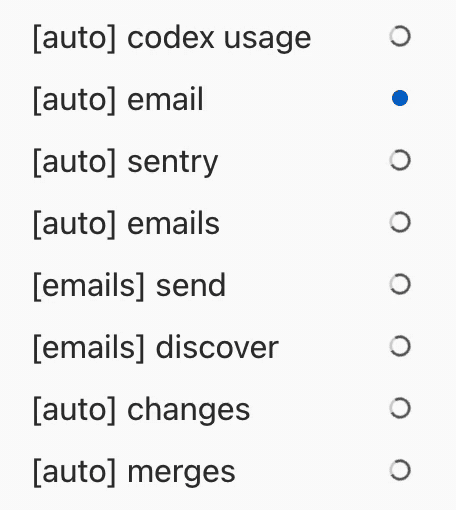
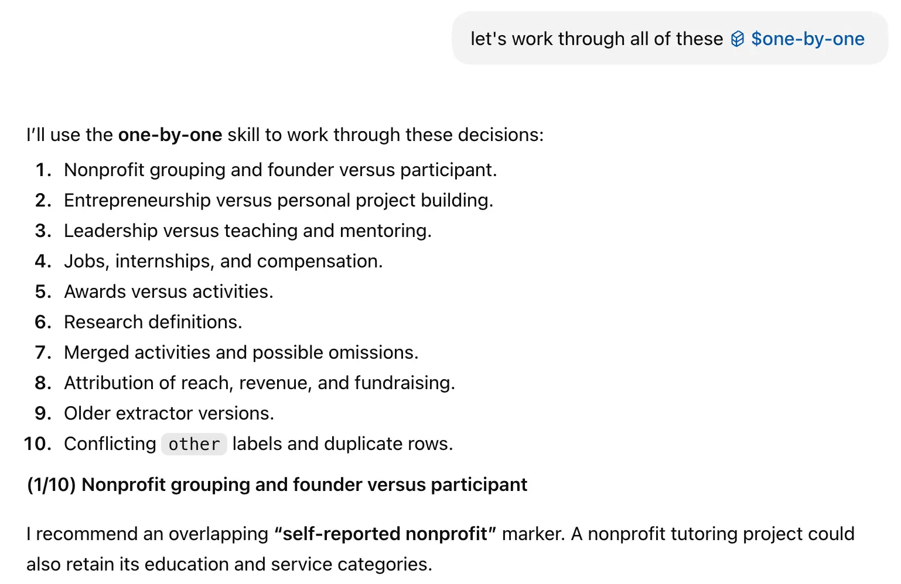
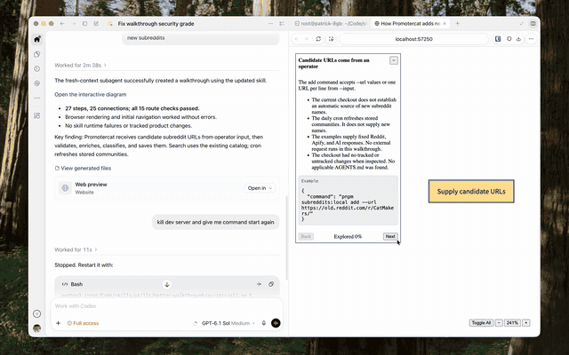

# (Better) Skills

A collection of agents skills to make more delightful software.

- [**better-clear-language**](skills/better-clear-language/SKILL.md): Write in clear, simple ([ASD-STE100 style](https://en.wikipedia.org/wiki/Simplified_Technical_English)) english.
- [**better-codex-superfan**](skills/better-codex-superfan/SKILL.md): Run a recurring task with codex goals, sleeping between runs. Workaround for [this](https://github.com/openai/codex/issues/34946).
- [**better-one-by-one**](skills/better-one-by-one/SKILL.md): Work through mentioned issues/tasks one by one, with progress tracker.
- [**better-walkthrough**](skills/better-walkthrough/SKILL.md): Use [D2 diagrams](https://d2lang.com/) to walk through code logic step-by-step.

## Install

```sh
npx skills add AlanChen4/skills -g
```

## Previews

<table width="100%">
  <thead>
    <tr>
      <th width="50%">Skill</th>
      <th width="50%"></th>
    </tr>
  </thead>
  <tbody>
    <tr>
      <td><a href="skills/better-clear-language/SKILL.md">better-clear-language</a></td>
      <td>"The purpose of this repo is to give coding agents instructions for specific tasks. This description uses better-clear-language, which helps agents write with common words and clear, active sentences. The skill checks for vague wording and removes filler while preserving the meaning."<br><br>- GPT 6.1 Sol, Medium</td>
    </tr>
    <tr>
      <td><a href="skills/better-codex-superfan/SKILL.md">better-codex-superfan</a></td>
      <td></td>
    </tr>
    <tr>
      <td><a href="skills/better-one-by-one/SKILL.md">better-one-by-one</a></td>
      <td></td>
    </tr>
    <tr>
      <td><a href="skills/better-walkthrough/SKILL.md">better-walkthrough</a></td>
      <td></td>
    </tr>
  </tbody>
</table>

## License

[MIT](LICENSE).
